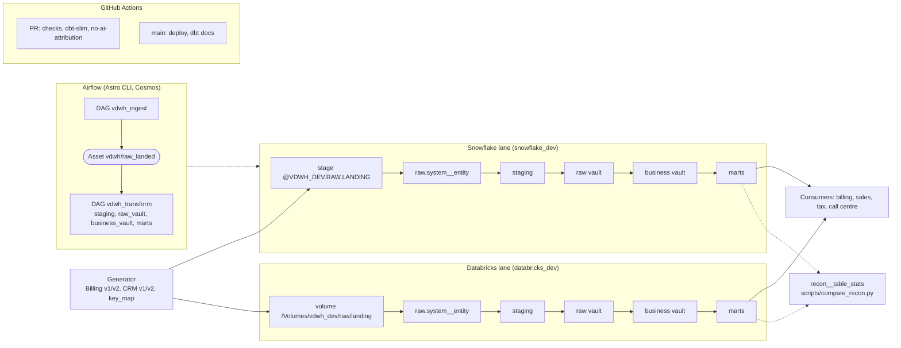
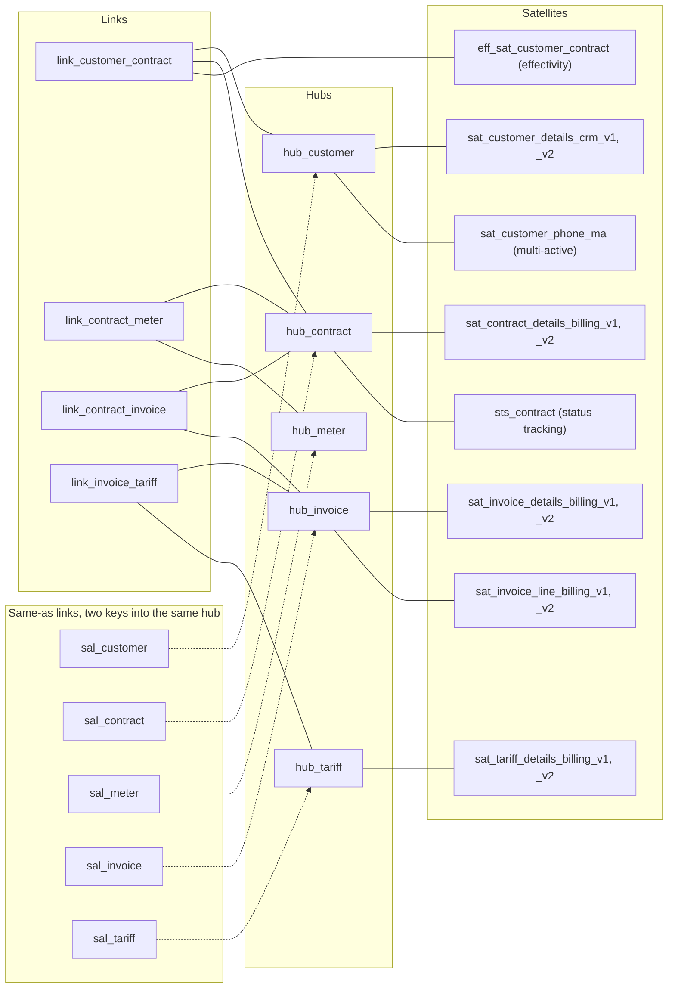
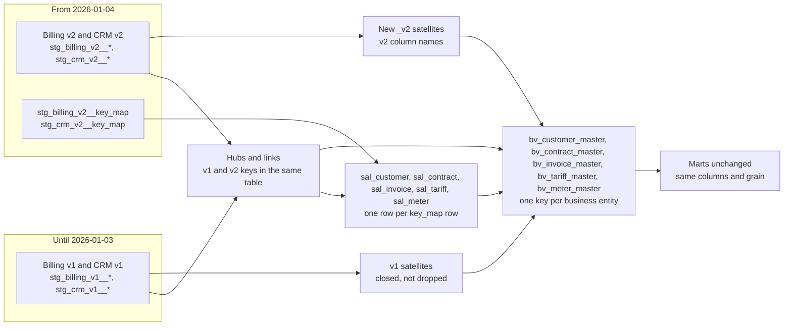
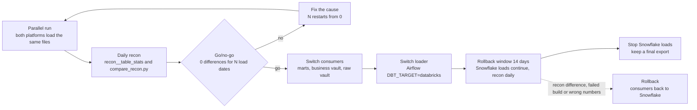
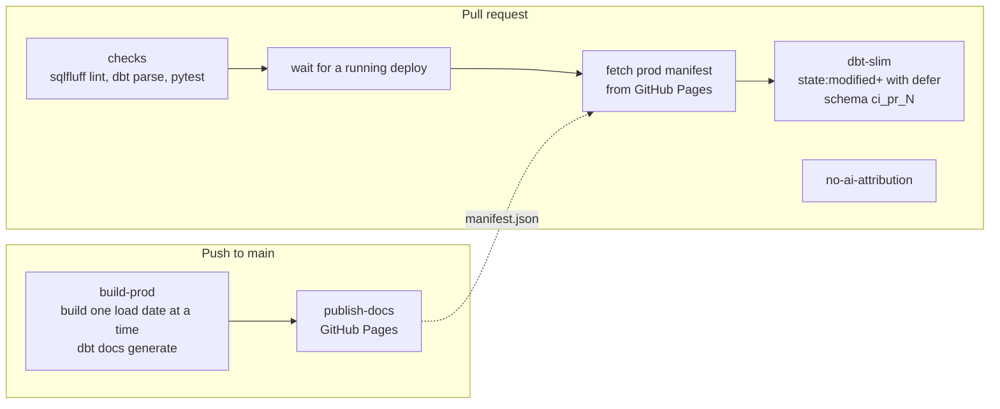
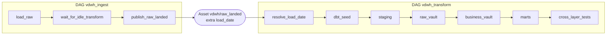

# vault-lakehouse-migration

[](https://github.com/aglivin/vault-lakehouse-migration/actions/workflows/ci.yml)
[](https://github.com/aglivin/vault-lakehouse-migration/actions/workflows/deploy.yml)

A Data Vault 2.0 warehouse for a fictional energy utility, built with dbt Core on Snowflake, orchestrated by Airflow, deployed by GitHub Actions and migrated to Databricks with the same dbt project.
All data is synthetic. See the [dbt docs](https://aglivin.github.io/vault-lakehouse-migration/).

## Where to start

| You are | Open first | Then |
|---|---|---|
| Analyst | [`dbt/models/marts`](dbt/models/marts) and the metrics in [`_exposures.yml`](dbt/models/marts/_exposures.yml) | The [dbt docs](https://aglivin.github.io/vault-lakehouse-migration/) for lineage and column descriptions |
| Engineer | [`dbt/models/raw_vault`](dbt/models/raw_vault) | [`dbt/macros`](dbt/macros), [`docs/loading.md`](docs/loading.md), then the [Quickstart](#quickstart) |
| Reviewer | [`.github/workflows/ci.yml`](.github/workflows/ci.yml) | [`dbt/tests`](dbt/tests), [`data/recon`](data/recon), [`docs/source-change.md`](docs/source-change.md) |

A guided tour of about 5 minutes: [`docs/walkthrough.md`](docs/walkthrough.md). How AI tooling was used: [`docs/ai-notes.md`](docs/ai-notes.md).

## Results

Hub, link and mart numbers measured on `snowflake_dev` after load date 2026-01-05 with `dbt show -s <analysis>`. Every number comes from a query or script in the repo.

| What | Result | Source |
|---|---|---|
| Hubs | customer 4204, contract 4153, meter 4204, invoice 7612, tariff 12 | `dbt/analyses/vault_row_counts.sql` |
| Links | customer-contract 4153, contract-meter 4153, contract-invoice 7612, invoice-tariff 7612 | `dbt/analyses/vault_row_counts.sql` |
| Mart vs expected totals | 4421 invoices, net total 461626.22 on both sides | `dbt/analyses/mart_vs_expected_totals.sql` |
| Snowflake vs Databricks | 0 differences in 35 tables (snapshot taken before the star-schema PRs, see Known limits) | `scripts/compare_recon.py` on `data/recon/*.json` |
| dbt models | 72 | `uv run dbt ls --project-dir dbt --profiles-dir dbt --resource-type model \| wc -l` |
| dbt tests | 226 | `uv run dbt ls --project-dir dbt --profiles-dir dbt --resource-type test \| wc -l` |

## Layers

| Layer | Path | Models | What it holds |
|---|---|---|---|
| Staging | `dbt/models/staging` | 21 | Views over raw tables for Billing v1/v2 and CRM v1/v2, with hash keys and hashdiffs |
| Raw vault | `dbt/models/raw_vault` | 31 | 5 hubs, 4 links, 4 non-historised links (contact, payment), 5 same-as links, satellites, effectivity and status tracking |
| Business vault | `dbt/models/business_vault` | 7 | One master model per entity, PIT and bridge tables |
| Marts | `dbt/models/marts` | 12 | Star schema and four data products: billing, sales, tax, call centre |
| Recon | `dbt/models/recon` | 1 | `recon__table_stats`, one row per table, used to compare platforms |
| Perf | `dbt/models/perf` | 0 | `perf_invoice_line_incremental`, disabled unless `perf_strategy` is set |
| Total | `dbt/models` | 72 | |

Source of the counts, run once per layer (here `marts`):

```bash
uv run dbt ls --project-dir dbt --profiles-dir dbt --target snowflake_dev --resource-type model --select path:models/marts -q | wc -l
```

## Architecture

Platform flow. The same dbt project runs on two lanes.



Detailed diagrams: [platform](docs/architecture-platform.drawio.svg), [vault model](docs/architecture-vault-model.drawio.svg), [source change and migration timeline](docs/architecture-change-migration.drawio.svg). Editable source: [`docs/architecture.drawio`](docs/architecture.drawio).

### Vault model

Hubs hold business keys. Links hold relationships. Satellites hold history. Names are the real dbt models.



Not drawn: the non-historised links `nhl_contact_crm_v1`, `nhl_contact_crm_v2`, `nhl_payment_billing_v1` and `nhl_payment_billing_v2`.

### Source change v1 to v2

From 2026-01-04 (dbt var `cutover_date`) the data comes from Billing v2 and CRM v2. Details and numbers: [`docs/source-change.md`](docs/source-change.md).



### Migration and cut-over

Plan, go/no-go rule and rollback: [`docs/cutover.md`](docs/cutover.md). Platform differences: [`docs/migration.md`](docs/migration.md).



### CI/CD

Workflows: [`ci.yml`](.github/workflows/ci.yml), [`attribution.yml`](.github/workflows/attribution.yml), [`deploy.yml`](.github/workflows/deploy.yml).



### Airflow

Details, alerts, backfill and target switch: [`docs/airflow.md`](docs/airflow.md). Graph: [`docs/img/airflow_graph.png`](docs/img/airflow_graph.png).



The four layer nodes are Cosmos task groups with one task per dbt model. `wait_for_idle_transform` holds the next event until the previous transform run ends, so each run gets one load date.

## Repository map

| Folder | What is stored | Open first |
|---|---|---|
| `data_generator/` | Synthetic sources: Billing v1/v2, CRM v1/v2, CDC changes, expected totals | [`world.py`](data_generator/world.py) |
| `dbt/models/staging` | Staging views per source system | [`stg_crm_v1__customers.sql`](dbt/models/staging/crm_v1/stg_crm_v1__customers.sql) |
| `dbt/models/raw_vault` | Hubs, links, same-as links, satellites | [`hub_customer.sql`](dbt/models/raw_vault/hubs/hub_customer.sql) |
| `dbt/models/business_vault` | Master models, PIT and bridge tables | [`bv_customer_master.sql`](dbt/models/business_vault/bv_customer_master.sql) |
| `dbt/models/marts` | Star schema and data products with contracts and exposures | [`fct_invoice_line.sql`](dbt/models/marts/core/fct_invoice_line.sql) |
| `dbt/models/recon` | Per-table stats for platform comparison | [`recon__table_stats.sql`](dbt/models/recon/recon__table_stats.sql) |
| `dbt/models/perf` | Incremental strategy probe, disabled by default | [`perf_invoice_line_incremental.sql`](dbt/models/perf/perf_invoice_line_incremental.sql) |
| `dbt/macros` | Raw loading, staging, cross-database helpers, load-date rule, CI cleanup | [`month_trunc.sql`](dbt/macros/compat/month_trunc.sql) |
| `dbt/analyses` | Queries behind the numbers in this repo | [`vault_row_counts.sql`](dbt/analyses/vault_row_counts.sql) |
| `dbt/tests` | Singular tests: reconciliation, history, source change | [`assert_mart_matches_expected_totals.sql`](dbt/tests/assert_mart_matches_expected_totals.sql) |
| `airflow/` | Astro project with the DAGs `vdwh_ingest` and `vdwh_transform` | [`vdwh_transform.py`](airflow/dags/vdwh_transform.py) |
| `scripts/` | Landing upload, per-date build, rerun check, platform comparison | [`build_by_load_date.sh`](scripts/build_by_load_date.sh) |
| `.github/workflows` | CI, deploy, attribution check | [`ci.yml`](.github/workflows/ci.yml) |
| `docs/` | Source change, migration, cut-over, loading, Airflow, performance, diagrams | [`source-change.md`](docs/source-change.md) |
| `data/recon` | Committed `recon__table_stats` output of both platforms | [`snowflake_dev.json`](data/recon/snowflake_dev.json) |
| `tests/` | pytest for the generator, upload and recon scripts | [`test_compare_recon.py`](tests/test_compare_recon.py) |

## Quickstart

Needs Python 3.12 with `uv`, the Snowflake CLI connection `personal` and the Databricks CLI profile `personal` (the upload script uses them), and a Snowflake or Databricks account.

```bash
git clone https://github.com/aglivin/vault-lakehouse-migration.git && cd vault-lakehouse-migration
uv sync
cp .env.example .env
set -a; source .env; set +a
uv run dbt deps --project-dir dbt --profiles-dir dbt --target snowflake_dev
uv run python -m data_generator
uv run dbt run-operation create_raw_tables --project-dir dbt --profiles-dir dbt --target snowflake_dev
for d in 2026-01-0{1..5}; do uv run python -m scripts.upload_landing --target snowflake --load-date $d && uv run dbt run-operation load_raw --args "{load_date: $d}" --project-dir dbt --profiles-dir dbt --target snowflake_dev; done
scripts/build_by_load_date.sh --project-dir dbt --profiles-dir dbt --target snowflake_dev
```

Fill in `.env` after the copy. `dbt/profiles.yml` reads env vars only. For Databricks use `--target databricks_dev` and `--target databricks` in the upload script. The build script runs `dbt build` once per load date.

## Known limits

- Databricks: the Unity Catalog metastore table quota of the free workspace is full (dropped tables still count until their retention ends). Models added after the reconciliation snapshot are built and tested on Snowflake only. In one local Astro run on 2026-11-15 (PR #29), the Airflow target switch ran 91 of 92 tasks green on Databricks; the last task needs a new table.
- Volumes are small (2000 customers by default, 50 000 for the performance runs).

## Roadmap

### Phase 0 — Accounts and local setup

- [x] Snowflake trial account (30 days), warehouse `XS`, role `TRANSFORMER`, database `VDWH_DEV`
- [x] Databricks Free Edition workspace (personal, not a client workspace), Unity Catalog `vdwh_dev`
- [x] Docker Desktop running; Astro CLI installed
- [x] `uv` project with `dbt-core`, `dbt-snowflake`, `dbt-databricks`, `sqlfluff`, `pre-commit`
- [x] Snowflake CLI (`snow`) installed
- [x] `profiles.yml` with targets `snowflake_dev` and `databricks_dev`; secrets only in env vars
- [x] GitHub Actions secrets for Snowflake and Databricks

### Phase 1 — Synthetic sources

- [x] Python generator for Billing v1, CRM v1 (Faker, fixed seed, default 2000 customers, scalable with `--customers`)
- [x] Billing v2, CRM v2 with new keys, renamed columns and a key-mapping table
- [x] Daily incremental loads with inserts, updates and deletes (for CDC behaviour)
- [x] Load to Snowflake stage and to a Databricks volume

### Phase 2 — dbt on Snowflake: Data Vault 2.0

- [x] Staging models with hash keys and hashdiffs (`automate_dv.stage`)
- [x] Hubs: customer, contract, meter, invoice, tariff
- [x] Links: customer–contract, contract–meter, contract–invoice, invoice–tariff
- [x] Satellites with history; one multi-active satellite (customer phone numbers)
- [x] Effectivity satellite for customer–contract
- [x] Status-tracking satellite (CDC deletes)
- [x] Incremental loads tested over 3 load dates
- [x] dbt tests: unique and not-null keys, relationships, freshness, row-count reconciliation to source

### Phase 3 — Source system change (v1 → v2)

- [x] Add v2 staging models next to v1
- [x] Same-as link between v1 and v2 business keys
- [x] New satellites for v2 attributes; old satellites closed, not dropped
- [x] Marts unchanged for consumers; reconciliation proves equal totals before and after the switch
- [x] Write-up: what changed in each layer and why ([docs/source-change.md](docs/source-change.md))

### Phase 4 — Business vault and marts

- [x] PIT tables and bridge tables for query performance
- [x] Star schema: `fct_invoice_line`, `fct_payment`, `dim_customer` (SCD2), `dim_contract`, `dim_tariff`, `dim_date`
- [x] Data products: billing, sales, tax, call centre
- [x] dbt docs and exposures; semantic definitions for the main metrics
- [x] Model contracts and versions on public marts

### Phase 5 — Airflow

- [x] Astro project, local Airflow in Docker
- [x] DAG: ingest → `dbt build` per layer with Cosmos (one task per model, tests included)
- [x] Sensors / dataset-driven scheduling between ingest and transform (Airflow 3 assets)
- [x] Retries, SLAs, alerting on failure (SLAs are Deadline Alerts in Airflow 3)
- [x] Backfill of a past load date (load rule and replay: [docs/loading.md](docs/loading.md))
- Runbook for the DAGs, assets, alerts, backfill and target switch: [docs/airflow.md](docs/airflow.md)

### Phase 6 — GitHub Actions CI/CD

- [x] PR workflow: `sqlfluff lint`, `dbt build --select state:modified+` (slim CI) against a PR schema
- [x] Main workflow: deploy to `prod` target, generate and publish dbt docs to GitHub Pages ([dbt docs](https://aglivin.github.io/vault-lakehouse-migration/))
- [x] Secrets in GitHub Actions secrets, no secrets in YAML; the deploy job runs in environment `prod`, limited to protected branches. In this demo CI and prod share one Snowflake account and credentials; prod is isolated by schema prefix
- [x] Branch protection on `main`: required green build (`checks`, `no-ai-attribution`, branch up to date); 1 approval in team mode (not enforced in this single-author repo)
- [x] Attribution check: build fails on AI co-author trailers

### Phase 7 — Migration Snowflake → Databricks

- [x] Inventory of Snowflake-specific SQL (`QUALIFY`, `VARIANT`, `FLATTEN`, time travel, `MERGE` behaviour, hash functions) ([docs/migration.md](docs/migration.md))
- [x] Cross-database macros (`dbt.dispatch`) so the same models run on both targets
- [x] Hash-key compatibility check: identical keys on both platforms
- [x] Run the full project on `databricks_dev` (Delta tables, Unity Catalog)
- [x] Data reconciliation job: row counts, sums and hash comparison per table, Snowflake vs Databricks
- [ ] Airflow DAG switched to the Databricks target with no DAG logic change (91 of 92 tasks green; blocked by Unity Catalog table quota)
- [x] Cut-over plan and rollback plan

### Phase 8 — Performance and cost

- [x] Snowflake: clustering keys, query profile of the slowest model ([performance.md](docs/performance.md))
- [x] Databricks: Liquid Clustering and `OPTIMIZE` measured on a serverless Photon warehouse
- [ ] Warehouse sizing comparison on both platforms (only X-Small and 2X-Small measured)
- [x] Incremental strategies compared (`merge`, `insert_overwrite`, `delete+insert`, `microbatch`)
- [x] Before/after numbers in a short table

### Phase 9 — Show and tell

- [x] Architecture diagram
- [x] 5-minute walkthrough script: business problem → vault → change of source → migration → CI/CD
- [x] Short notes on how Claude Code was used, and where it was wrong

Work in progress. Unticked boxes are not done.
