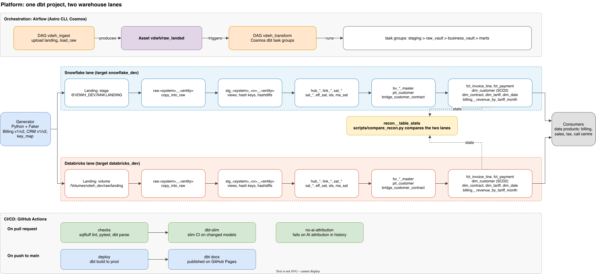
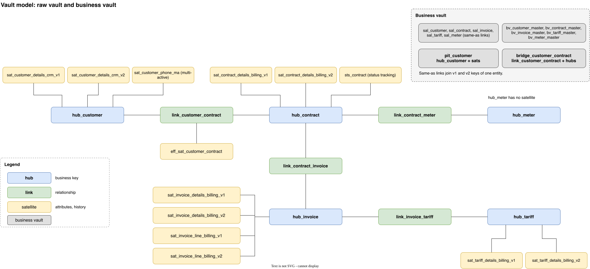
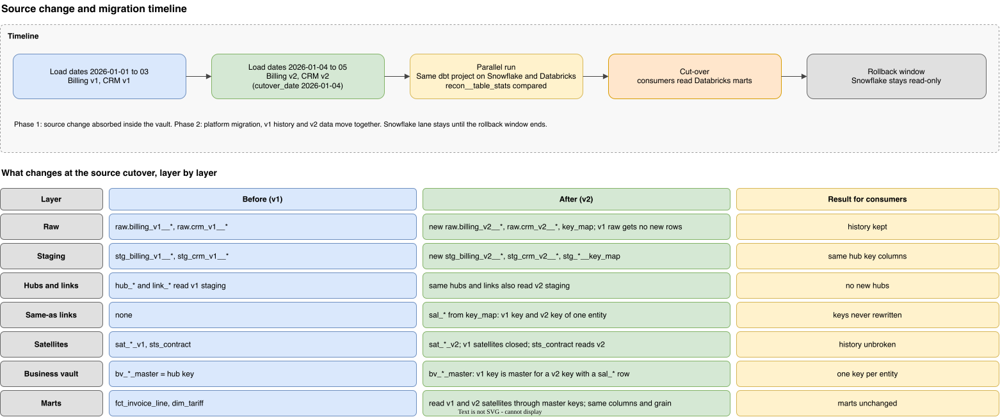
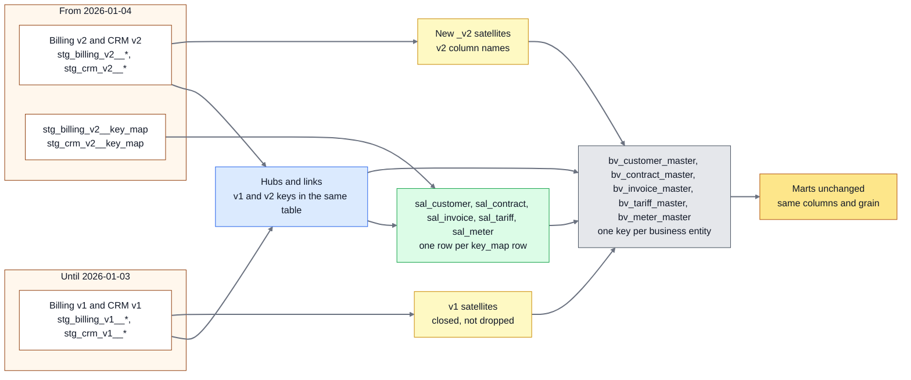
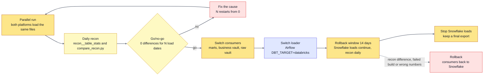
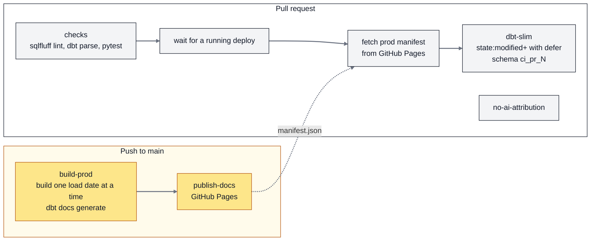

# vault-lakehouse-migration

[](https://github.com/aglivin/vault-lakehouse-migration/actions/workflows/ci.yml)
[](https://github.com/aglivin/vault-lakehouse-migration/actions/workflows/deploy.yml)
[](https://aglivin.github.io/vault-lakehouse-migration/)


A Data Vault 2.0 warehouse that survives a source-system change and a move from Snowflake to Databricks, built with dbt Core, Airflow and GitHub Actions. All data is synthetic.

**[Architecture overview (2 min read)](https://aglivin.github.io/vault-lakehouse-migration/overview.html)** · [dbt docs and live lineage](https://aglivin.github.io/vault-lakehouse-migration/)

## How it is built

One dbt project loads two warehouse lanes, Snowflake and Databricks. Airflow runs the loads. GitHub Actions checks and deploys them.



Editable source of all diagrams: [`docs/architecture.drawio`](docs/architecture.drawio).

## How data flows

Each layer is a folder of dbt models. The example models are real.

```mermaid
flowchart LR
    LAND["<b>Landing</b><br/>CSV per<br/>load date"] --> RAWT["<b>raw</b><br/>crm_v1__<br/>customers"] --> STG["<b>staging</b><br/>stg_crm_v1__<br/>customers"] --> RV["<b>raw vault</b><br/>hub_customer<br/>sat_customer_*"] --> BV["<b>business vault</b><br/>bv_customer_master<br/>pit_customer"] --> MT["<b>marts</b><br/>fct_invoice_line<br/>dim_customer"] --> CONS["<b>consumers</b><br/>billing, sales<br/>tax, call centre"]
    classDef raw fill:#f5e6d3,stroke:#92400e,color:#111827
    classDef stg fill:#ffffff,stroke:#92400e,color:#111827
    classDef hub fill:#dbeafe,stroke:#2563eb,color:#111827
    classDef bv fill:#e5e7eb,stroke:#4b5563,color:#111827
    classDef mart fill:#fde68a,stroke:#b45309,color:#111827
    classDef user fill:#ffffff,stroke:#4b5563,color:#111827
    class LAND,RAWT raw
    class STG stg
    class RV hub
    class BV bv
    class MT mart
    class CONS user
    linkStyle default stroke:#6b7280,stroke-width:2px
```



## Vault model

Hubs hold business keys. Links hold relationships. Satellites hold history. Names are the real dbt models.



Not drawn: the non-historised links `nhl_contact_crm_v1`, `nhl_contact_crm_v2`, `nhl_payment_billing_v1` and `nhl_payment_billing_v2`.

<details>
<summary><strong>Source change v1 to v2</strong></summary>

From 2026-01-04 (dbt var `cutover_date`) the data comes from Billing v2 and CRM v2. Details and numbers: [`docs/source-change.md`](docs/source-change.md).





</details>

<details>
<summary><strong>Migration and cut-over</strong></summary>

Plan, go/no-go rule and rollback: [`docs/cutover.md`](docs/cutover.md). Platform differences: [`docs/migration.md`](docs/migration.md).



</details>

<details>
<summary><strong>CI/CD</strong></summary>

Workflows: [`ci.yml`](.github/workflows/ci.yml), [`attribution.yml`](.github/workflows/attribution.yml), [`deploy.yml`](.github/workflows/deploy.yml).



</details>

<details>
<summary><strong>Airflow</strong></summary>

Details, alerts, backfill and target switch: [`docs/airflow.md`](docs/airflow.md). Graph: [`docs/img/airflow_graph.png`](docs/img/airflow_graph.png).

```mermaid
flowchart LR
    subgraph ING["DAG vdwh_ingest"]
        LRAW["load_raw"] --> WAIT["wait_for_idle_transform"] --> PUB["publish_raw_landed"]
    end
    PUB --> AST(["Asset vdwh/raw_landed<br/>extra load_date"])
    AST --> RLD
    subgraph TRF["DAG vdwh_transform"]
        RLD["resolve_load_date"] --> SEED["dbt_seed"] --> ST["staging"] --> RV["raw_vault"] --> BV["business_vault"] --> MA["marts"] --> XT["cross_layer_tests"]
    end
    classDef af fill:#e0e7ff,stroke:#4f46e5,color:#111827
    classDef asset fill:#ffffff,stroke:#4f46e5,stroke-width:3px,color:#111827
    class LRAW,WAIT,PUB,RLD,SEED,ST,RV,BV,MA,XT af
    class AST asset
    style ING fill:#eef2ff,stroke:#4f46e5,color:#111827
    style TRF fill:#eef2ff,stroke:#4f46e5,color:#111827
    linkStyle default stroke:#6b7280,stroke-width:2px
```



The four layer nodes are Cosmos task groups with one task per dbt model. `wait_for_idle_transform` holds the next event until the previous transform run ends, so each run gets one load date.

</details>

[Where to start](#where-to-start) · [Repository map](#repository-map) · [Getting started](#getting-started) · [Scenario](#scenario) · [Results](#results) · [Layers](#layers) · [Known limits](#known-limits) · [Roadmap](#roadmap)

## Where to start

| You are | Open first | Then |
|---|---|---|
| Analyst | [`dbt/models/marts`](dbt/models/marts) and the metrics in [`_exposures.yml`](dbt/models/marts/_exposures.yml) | The [dbt docs](https://aglivin.github.io/vault-lakehouse-migration/) for lineage and column descriptions |
| Engineer | [`dbt/models/raw_vault`](dbt/models/raw_vault) | [`dbt/macros`](dbt/macros), [`docs/loading.md`](docs/loading.md), then [Getting started](#getting-started) |
| Reviewer | [`.github/workflows/ci.yml`](.github/workflows/ci.yml) | [`dbt/tests`](dbt/tests), [`data/recon`](data/recon), [`docs/source-change.md`](docs/source-change.md) |

A 5-minute tour:

1. [Source change](docs/source-change.md): Billing and CRM v1 are replaced by v2, and the marts do not change.
2. [Migration](docs/migration.md): one dbt project on both platforms; dialect gaps live in dispatch macros.
3. [Cut-over and rollback](docs/cutover.md): parallel run, reconciliation, go/no-go rule.
4. [Performance](docs/performance.md): clustering and incremental strategies, measured from query history.
5. [Airflow DAGs](docs/airflow.md): asset scheduling, alerts, backfill ([graph](docs/img/airflow_graph.png)).
6. [CI](.github/workflows/ci.yml): lint, slim build against the prod manifest, attribution check.

A spoken version of this tour: [`docs/walkthrough.md`](docs/walkthrough.md). How AI tooling was used: [`docs/ai-notes.md`](docs/ai-notes.md).

## Repository map

| Folder | What is stored | Open first |
|---|---|---|
| `data_generator/` | Synthetic sources: Billing v1/v2, CRM v1/v2, CDC changes, expected totals | [`world.py`](data_generator/world.py) |
| `dbt/models/staging` | Staging views per source system | [`stg_crm_v1__customers.sql`](dbt/models/staging/crm_v1/stg_crm_v1__customers.sql) |
| `dbt/models/raw_vault` | Hubs, links, same-as links, satellites | [`hub_customer.sql`](dbt/models/raw_vault/hubs/hub_customer.sql) |
| `dbt/models/business_vault` | Master models, PIT and bridge tables | [`bv_customer_master.sql`](dbt/models/business_vault/bv_customer_master.sql) |
| `dbt/models/marts` | Star schema and data products with contracts and exposures | [`fct_invoice_line.sql`](dbt/models/marts/core/fct_invoice_line.sql) |
| `dbt/models/recon` | Per-table stats for platform comparison | [`recon__table_stats.sql`](dbt/models/recon/recon__table_stats.sql) |
| `dbt/models/perf` | Incremental strategy probe, disabled by default | [`perf_invoice_line_incremental.sql`](dbt/models/perf/perf_invoice_line_incremental.sql) |
| `dbt/macros` | Raw loading, staging, cross-database helpers, load-date rule, CI cleanup | [`month_trunc.sql`](dbt/macros/compat/month_trunc.sql) |
| `dbt/analyses` | Queries behind the numbers in this repo | [`vault_row_counts.sql`](dbt/analyses/vault_row_counts.sql) |
| `dbt/tests` | Singular tests: reconciliation, history, source change | [`assert_mart_matches_expected_totals.sql`](dbt/tests/assert_mart_matches_expected_totals.sql) |
| `airflow/` | Astro project with the DAGs `vdwh_ingest` and `vdwh_transform` | [`vdwh_transform.py`](airflow/dags/vdwh_transform.py) |
| `scripts/` | Landing upload, per-date build, rerun check, platform comparison | [`build_by_load_date.sh`](scripts/build_by_load_date.sh) |
| `.github/workflows` | CI, deploy, attribution check | [`ci.yml`](.github/workflows/ci.yml) |
| `docs/` | Source change, migration, cut-over, loading, Airflow, performance, diagrams | [`source-change.md`](docs/source-change.md) |
| `data/recon` | Committed `recon__table_stats` output of both platforms | [`snowflake_dev.json`](data/recon/snowflake_dev.json) |
| `tests/` | pytest for the generator, upload and recon scripts | [`test_compare_recon.py`](tests/test_compare_recon.py) |

## Getting started

The Snowflake path needs:

- Python 3.12 with `uv`;
- a Snowflake account with key-pair auth;
- the Snowflake CLI (`snow`) with a connection named `personal` (the upload script uses it).

The Databricks CLI is not needed for the Snowflake path. Docker and the Astro CLI are needed only for the Airflow step 14.

For Databricks instead: the Databricks CLI profile `personal`, `--target databricks_dev` in the dbt commands and `--target databricks` in the upload script.

1. Clone the repo.

   ```bash
   git clone https://github.com/aglivin/vault-lakehouse-migration.git
   cd vault-lakehouse-migration
   ```

2. Install the Python packages.

   ```bash
   uv sync
   ```

3. Create `.env` from the template.

   ```bash
   cp .env.example .env
   ```

4. Edit `.env` now, before you load it. Fill in `SNOWFLAKE_ACCOUNT`, `SNOWFLAKE_USER` and `SNOWFLAKE_PRIVATE_KEY_PATH` (absolute path of the `.p8` key), and check role, warehouse and database. `dbt/profiles.yml` reads env vars only.

   Optional: change `DBT_DEV_SCHEMA` from `dev` to your own schema, so that you do not share the `dev` schema with other runs.

5. Load `.env` into the shell. Repeat this in every new shell.

   ```bash
   set -a; source .env; set +a
   ```

6. Generate the synthetic Billing and CRM files and the expected totals.

   ```bash
   uv run python -m data_generator
   ```

7. Install the dbt packages.

   ```bash
   uv run dbt deps --project-dir dbt --profiles-dir dbt --target snowflake_dev
   ```

8. Create the raw tables.

   ```bash
   uv run dbt run-operation create_raw_tables --project-dir dbt --profiles-dir dbt --target snowflake_dev
   ```

9. Load the raw tables, one load date at a time. Each date is uploaded to the stage, then copied into raw (about 3 minutes in total).

   ```bash
   for d in 2026-01-0{1..5}; do
     uv run python -m scripts.upload_landing --target snowflake --load-date $d
     uv run dbt run-operation load_raw --args "{load_date: $d}" --project-dir dbt --profiles-dir dbt --target snowflake_dev
   done
   ```

10. Build staging, raw vault, business vault and marts, one load date at a time.

    ```bash
    scripts/build_by_load_date.sh --project-dir dbt --profiles-dir dbt --target snowflake_dev
    ```

11. Run the Python tests.

    ```bash
    uv run pytest -q
    ```

12. Run the dbt tests on the last load date.

    ```bash
    uv run dbt test --project-dir dbt --profiles-dir dbt --target snowflake_dev --vars "{load_date: '2026-01-05'}"
    ```

13. Check the mart totals against the expected totals in `dbt/seeds/expected_totals.csv`: 4421 invoices, net total 461626.22, VAT total 92325.66.

    ```bash
    uv run dbt show --select mart_vs_expected_totals --project-dir dbt --profiles-dir dbt --target snowflake_dev --vars "{load_date: '2026-01-05'}"
    uv run dbt show --inline "select count(*) as invoices, sum(vat_amount) as vat_total from {{ ref('tax__vat_by_invoice') }}" --project-dir dbt --profiles-dir dbt --target snowflake_dev
    ```

    The first query returns invoices and net total. The second returns the VAT total; the test `assert_vat_matches_expected_totals` checks the same value in step 12.

14. Optional: run the same flow in Airflow (Docker and the Astro CLI). Full runbook: [`docs/airflow.md`](docs/airflow.md#local-run).

    1. Create `airflow/.env` from the template and copy the Snowflake values and `DBT_DEV_SCHEMA` from the root `.env`. Keep `SNOWFLAKE_PRIVATE_KEY_PATH=/usr/local/airflow/secrets/snowflake_key.p8`: this is the key path inside the container. The template already sets `AIRFLOW__CORE__PARALLELISM=4`.

       ```bash
       cp airflow/.env.example airflow/.env
       ```

    2. Create the Astro project file. `airflow/.astro/` is git-ignored, so a fresh clone does not have it. Do not run `astro dev init`: it overwrites the Dockerfile, the requirements and the DAGs.

       ```bash
       cd airflow
       mkdir -p .astro && printf 'project:\n  name: vdwh\n' > .astro/config.yaml
       ```

    3. Export the host path of the Snowflake key (from the root `.env` loaded in step 5). Docker Compose needs it for `astro dev start` and for `astro dev stop`.

       ```bash
       export SNOWFLAKE_KEY_FILE="$SNOWFLAKE_PRIVATE_KEY_PATH"
       ```

    4. Start Airflow, wait until the DAGs are parsed (about 40 seconds), then unpause and trigger the first load date.

       ```bash
       astro dev start
       until astro dev run dags list 2>/dev/null | grep -q vdwh_transform; do sleep 10; done
       astro dev run dags unpause vdwh_ingest
       astro dev run dags unpause vdwh_transform
       astro dev run dags trigger vdwh_ingest --logical-date 2026-01-01T00:00:00+00:00
       ```

    Run the load dates in order. For several dates use a backfill, see [`docs/airflow.md`](docs/airflow.md#backfill). Airflow runs at http://localhost:8080. Stop it with `astro dev stop` in a shell where `SNOWFLAKE_KEY_FILE` is exported.

15. Optional: build and open the dbt docs with lineage.

    ```bash
    cd ..
    uv run dbt docs generate --project-dir dbt --profiles-dir dbt --target snowflake_dev
    uv run dbt docs serve --project-dir dbt --profiles-dir dbt
    ```

Every dbt command prints `Unknown parameter 'reuse_connections'` and `'insecure_mode'` warnings. They come from the Snowflake connector and are noise only.

## Scenario

A utility sells electricity and gas to residential customers. Data comes from two operational systems:

- **Billing**: contracts, meters, tariffs, invoices, invoice lines, payments
- **CRM**: customers, phone numbers, call-centre contacts

On load date 2026-01-04 both systems are replaced (Billing v1 → v2, CRM v1 → v2) with new keys and new column names. The Data Vault absorbs the change with no break in history and no change for consumers. After that, the whole warehouse moves from Snowflake to Databricks with the same dbt project.

| Area | Tool |
|---|---|
| Warehouse | Snowflake (current), Databricks with Unity Catalog (target) |
| Transformation | dbt Core, `automate_dv` (Data Vault 2.0), `dbt_utils` |
| Orchestration | Apache Airflow 3 (Astro CLI, `astronomer-cosmos`) |
| CI/CD | GitHub Actions, GitHub Pages for dbt docs |
| Quality | dbt tests and contracts, `sqlfluff`, `pytest`, `pre-commit` |

## Results

Hub, link and mart numbers measured on `snowflake_dev` after load date 2026-01-05 with `dbt show -s <analysis>`. Every number comes from a query or script in the repo.

| What | Result | Source |
|---|---|---|
| Hubs | customer 4204, contract 4153, meter 4204, invoice 7612, tariff 12 | `dbt/analyses/vault_row_counts.sql` |
| Links | customer-contract 4153, contract-meter 4153, contract-invoice 7612, invoice-tariff 7612 | `dbt/analyses/vault_row_counts.sql` |
| Mart vs expected totals | 4421 invoices, net total 461626.22, equal on `snowflake_dev` and `databricks_dev` | `dbt/analyses/mart_vs_expected_totals.sql`, table in [`docs/migration.md`](docs/migration.md#result) |
| Snowflake vs Databricks | 0 differences in 35 tables (snapshot taken before the star-schema PRs, see Known limits) | `scripts/compare_recon.py` on `data/recon/*.json` |
| dbt models | 72 | `uv run dbt ls --project-dir dbt --profiles-dir dbt --resource-type model \| wc -l` |
| dbt tests | 226 | `uv run dbt ls --project-dir dbt --profiles-dir dbt --resource-type test \| wc -l` |

## Layers

| Layer | Path | Models | What it holds |
|---|---|---|---|
| Staging | `dbt/models/staging` | 21 | Views over raw tables for Billing v1/v2 and CRM v1/v2, with hash keys and hashdiffs |
| Raw vault | `dbt/models/raw_vault` | 31 | 5 hubs, 4 links, 4 non-historised links (contact, payment), 5 same-as links, satellites, effectivity and status tracking |
| Business vault | `dbt/models/business_vault` | 7 | One master model per entity, PIT and bridge tables |
| Marts | `dbt/models/marts` | 12 | Star schema and four data products: billing, sales, tax, call centre |
| Recon | `dbt/models/recon` | 1 | `recon__table_stats`, one row per table, used to compare platforms |
| Perf | `dbt/models/perf` | 0 | `perf_invoice_line_incremental`, disabled unless `perf_strategy` is set |
| Total | `dbt/models` | 72 | |

Source of the counts, run once per layer (here `marts`):

```bash
uv run dbt ls --project-dir dbt --profiles-dir dbt --target snowflake_dev --resource-type model --select path:models/marts -q | wc -l
```

## Known limits

- Databricks: the Unity Catalog metastore table quota of the free workspace is full (dropped tables still count until their retention ends). Models added after the reconciliation snapshot are built and tested on Snowflake only. In one local Astro run on 2026-11-15 (PR #29), the Airflow target switch ran 91 of 92 tasks green on Databricks; the last task needs a new table.
- Performance: only X-Small and 2X-Small warehouses were measured, so there is no full sizing comparison.
- Volumes are small (2000 customers by default, 50 000 for the performance runs).

## Roadmap

52 of 54 items done. The two open items are listed under [Known limits](#known-limits).

<details>
<summary>Show all phases</summary>

### Phase 0 — Accounts and local setup

- [x] Snowflake trial account (30 days), warehouse `XS`, role `TRANSFORMER`, database `VDWH_DEV`
- [x] Databricks Free Edition workspace (personal), Unity Catalog `vdwh_dev`
- [x] Docker Desktop running; Astro CLI installed
- [x] `uv` project with `dbt-core`, `dbt-snowflake`, `dbt-databricks`, `sqlfluff`, `pre-commit`
- [x] Snowflake CLI (`snow`) installed
- [x] `profiles.yml` with targets `snowflake_dev` and `databricks_dev`; secrets only in env vars
- [x] GitHub Actions secrets for Snowflake and Databricks

### Phase 1 — Synthetic sources

- [x] Python generator for Billing v1, CRM v1 (Faker, fixed seed, default 2000 customers, scalable with `--customers`)
- [x] Billing v2, CRM v2 with new keys, renamed columns and a key-mapping table
- [x] Daily incremental loads with inserts, updates and deletes (for CDC behaviour)
- [x] Load to Snowflake stage and to a Databricks volume

### Phase 2 — dbt on Snowflake: Data Vault 2.0

- [x] Staging models with hash keys and hashdiffs (`automate_dv.stage`)
- [x] Hubs: customer, contract, meter, invoice, tariff
- [x] Links: customer–contract, contract–meter, contract–invoice, invoice–tariff
- [x] Satellites with history; one multi-active satellite (customer phone numbers)
- [x] Effectivity satellite for customer–contract
- [x] Status-tracking satellite (CDC deletes)
- [x] Incremental loads tested over 3 load dates
- [x] dbt tests: unique and not-null keys, relationships, freshness, row-count reconciliation to source

### Phase 3 — Source system change (v1 → v2)

- [x] Add v2 staging models next to v1
- [x] Same-as link between v1 and v2 business keys
- [x] New satellites for v2 attributes; old satellites closed, not dropped
- [x] Marts unchanged for consumers; reconciliation proves equal totals before and after the switch
- [x] Write-up: what changed in each layer and why ([docs/source-change.md](docs/source-change.md))

### Phase 4 — Business vault and marts

- [x] PIT tables and bridge tables for query performance
- [x] Star schema: `fct_invoice_line`, `fct_payment`, `dim_customer` (SCD2), `dim_contract`, `dim_tariff`, `dim_date`
- [x] Data products: billing, sales, tax, call centre
- [x] dbt docs and exposures; semantic definitions for the main metrics
- [x] Model contracts and versions on public marts

### Phase 5 — Airflow

- [x] Astro project, local Airflow in Docker
- [x] DAG: ingest → `dbt build` per layer with Cosmos (one task per model, tests included)
- [x] Sensors / dataset-driven scheduling between ingest and transform (Airflow 3 assets)
- [x] Retries, SLAs, alerting on failure (SLAs are Deadline Alerts in Airflow 3)
- [x] Backfill of a past load date (load rule and replay: [docs/loading.md](docs/loading.md))
- Runbook for the DAGs, assets, alerts, backfill and target switch: [docs/airflow.md](docs/airflow.md)

### Phase 6 — GitHub Actions CI/CD

- [x] PR workflow: `sqlfluff lint`, `dbt build --select state:modified+` (slim CI) against a PR schema
- [x] Main workflow: deploy to `prod` target, generate and publish dbt docs to GitHub Pages ([dbt docs](https://aglivin.github.io/vault-lakehouse-migration/))
- [x] Secrets in GitHub Actions secrets, no secrets in YAML; the deploy job runs in environment `prod`, limited to protected branches. In this demo CI and prod share one Snowflake account and credentials; prod is isolated by schema prefix
- [x] Branch protection on `main`: required green build (`checks`, `no-ai-attribution`, branch up to date); 1 approval in team mode (not enforced in this single-author repo)
- [x] Attribution check: build fails on AI co-author trailers

### Phase 7 — Migration Snowflake → Databricks

- [x] Inventory of Snowflake-specific SQL (`QUALIFY`, `VARIANT`, `FLATTEN`, time travel, `MERGE` behaviour, hash functions) ([docs/migration.md](docs/migration.md))
- [x] Cross-database macros (`dbt.dispatch`) so the same models run on both targets
- [x] Hash-key compatibility check: identical keys on both platforms
- [x] Run the full project on `databricks_dev` (Delta tables, Unity Catalog)
- [x] Data reconciliation job: row counts, sums and hash comparison per table, Snowflake vs Databricks
- [ ] Airflow DAG switched to the Databricks target with no DAG logic change (91 of 92 tasks green; blocked by Unity Catalog table quota)
- [x] Cut-over plan and rollback plan

### Phase 8 — Performance and cost

- [x] Snowflake: clustering keys, query profile of the slowest model ([performance.md](docs/performance.md))
- [x] Databricks: Liquid Clustering and `OPTIMIZE` measured on a serverless Photon warehouse
- [ ] Warehouse sizing comparison on both platforms (only X-Small and 2X-Small measured)
- [x] Incremental strategies compared (`merge`, `insert_overwrite`, `delete+insert`, `microbatch`)
- [x] Before/after numbers in a short table

### Phase 9 — Show and tell

- [x] Architecture diagram
- [x] 5-minute walkthrough script: business problem → vault → change of source → migration → CI/CD
- [x] Short notes on how Claude Code was used, and where it was wrong

</details>
